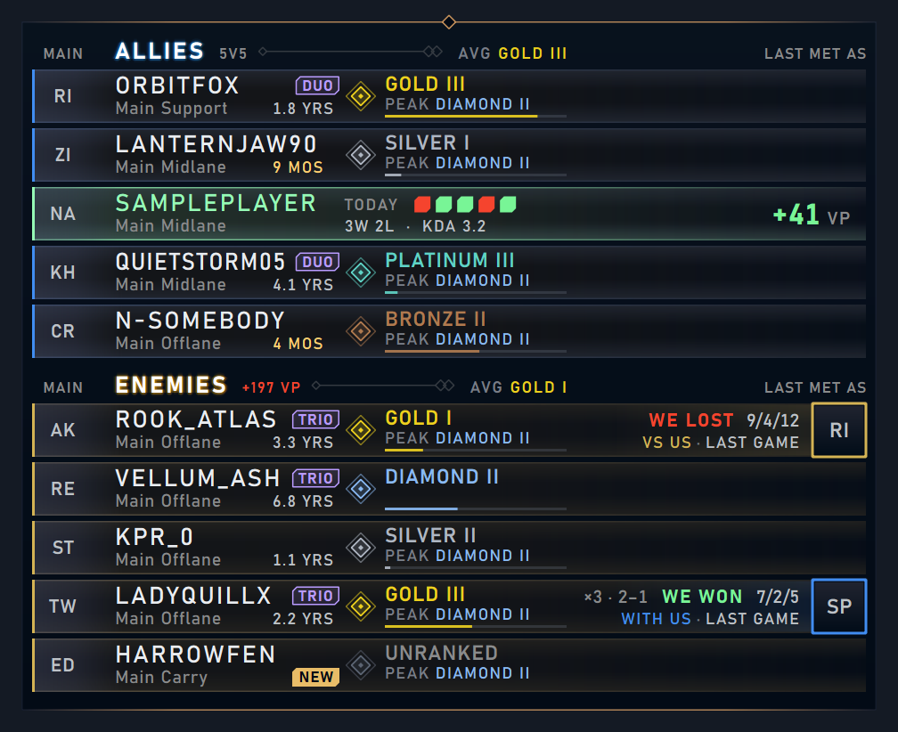
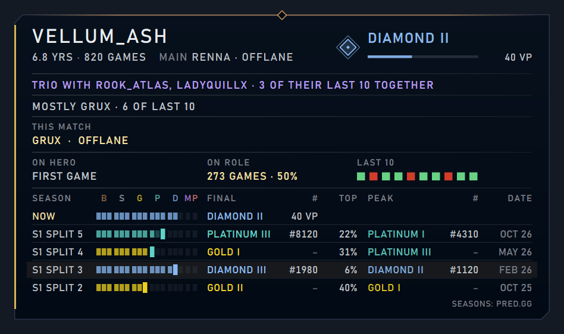

# Pred Overlay

A small Windows tray app that shows who you are playing with in Predecessor: rank and VP this season, best rank of past seasons, usual hero and role, and whether you met someone in your recent matches. It draws over the game in the draft, on the loading screen and while you hold TAB.

It reads only what the game shows you: the player names on the draft, loading and scoreboard screens (with its own small text recognizer, trained on the open fonts the game uses, and Windows' built-in OCR) and the game's log file. It looks those names up on [Pred.gg](https://pred.gg) with your own Pred.gg account. It never talks to Omeda's servers and never touches the game process.

Unofficial fan project, not affiliated with or endorsed by Omeda Studios or Pred.gg; the hero art belongs to Omeda Studios.



## Install

You need Windows 10 or 11 (64-bit), Predecessor on PC launched at least once, the game in **Windowed Fullscreen**, and a Pred.gg account (you can create one when you sign in). Details under [Requirements](#requirements).

### Setup

1. Download `PredOverlay-v<version>-setup.exe` from [Releases](https://github.com/TheWeaklessOne/pred-overlay/releases/latest).
2. Run it. The setup is not code-signed, so Windows SmartScreen may say "Windows protected your PC": click **More info**, then **Run anyway**.
3. Click **Install**. It needs no administrator rights, installs to `%LOCALAPPDATA%\Programs\PredOverlay` and starts the app when it finishes.

To remove it later, go to Settings, **Apps**, **Installed apps**, and pick Pred Overlay. The uninstaller asks whether to delete your settings and sign-in too.

### Or paste into PowerShell

Open PowerShell (Start menu, type `powershell`, Enter) and paste this. It downloads the latest release from this repository, checks its SHA-256, unpacks it to `%LOCALAPPDATA%\Programs\PredOverlay` and starts it. No administrator rights needed.

```powershell
& {
  $ErrorActionPreference = 'Stop'   # a failed download or check ends it here: nothing is removed
  $ProgressPreference = 'SilentlyContinue'
  $release = Invoke-RestMethod https://api.github.com/repos/TheWeaklessOne/pred-overlay/releases/latest
  $zip = $release.assets | Where-Object name -like 'PredOverlay-*-win64.zip' | Select-Object -First 1
  $sums = $release.assets | Where-Object name -eq 'SHA256SUMS.txt'
  $file = Join-Path $env:TEMP $zip.name
  Invoke-WebRequest $zip.browser_download_url -OutFile $file -UseBasicParsing
  Invoke-WebRequest $sums.browser_download_url -OutFile "$file.sha256" -UseBasicParsing
  $line = Get-Content "$file.sha256" | Where-Object { $_ -like "*  $($zip.name)" } | Select-Object -First 1
  if (-not $line -or ($line -split '\s+')[0] -ne (Get-FileHash $file -Algorithm SHA256).Hash) { throw 'Checksum mismatch, not installing' }
  Unblock-File $file
  $cli = "$env:LOCALAPPDATA\Programs\PredOverlay\PredOverlayCLI.exe"
  if (Test-Path $cli) { & $cli --quit }
  Get-Process PredOverlay, PredOverlayCLI -ErrorAction SilentlyContinue | Stop-Process -PassThru | Wait-Process
  Remove-Item "$env:LOCALAPPDATA\Programs\PredOverlay" -Recurse -Force -ErrorAction SilentlyContinue
  Expand-Archive $file -DestinationPath "$env:LOCALAPPDATA\Programs" -Force
  Start-Process "$env:LOCALAPPDATA\Programs\PredOverlay\PredOverlay.exe"
}
```

### Or unzip it by hand

1. Download `PredOverlay-v<version>-win64.zip` from [Releases](https://github.com/TheWeaklessOne/pred-overlay/releases/latest).
2. Right-click the zip, **Properties**, tick **Unblock**, OK.
3. Extract it to `%LOCALAPPDATA%\Programs` (Explorer's **Extract All** adds the zip's name to the destination: delete it). The zip already contains a `PredOverlay` folder, so you get `%LOCALAPPDATA%\Programs\PredOverlay\PredOverlay.exe`.
4. Run `PredOverlay.exe`. The build is not code-signed, so Windows SmartScreen may warn: click **More info**, then **Run anyway**.

### Or let an AI agent do it

Paste this into Claude Code, Codex or any other agent that can run commands on your PC:

```text
Install Pred Overlay on this Windows PC. Follow https://raw.githubusercontent.com/TheWeaklessOne/pred-overlay/main/docs/agents/install.md step by step, verify each step, and ask me before anything that needs administrator rights or changes the game's settings.
```

[docs/agents/install.md](docs/agents/install.md) takes the agent through the checks, the install, the display mode, the first start and troubleshooting. The same guide covers the other jobs an agent can do for you:

```text
Pred Overlay misbehaves on this PC. Find out why with its --check and its log, following the Troubleshooting section of https://raw.githubusercontent.com/TheWeaklessOne/pred-overlay/main/docs/agents/install.md, and fix what you can.
```

```text
Reinstall the latest Pred Overlay release on this PC as step 2 of https://raw.githubusercontent.com/TheWeaklessOne/pred-overlay/main/docs/agents/install.md describes, keeping my settings and sign-in.
```

```text
Collect Pred Overlay's diagnostics as https://raw.githubusercontent.com/TheWeaklessOne/pred-overlay/main/docs/agents/install.md describes and tell me where the zip is. Do not upload it.
```

```text
Uninstall Pred Overlay from this PC as the Uninstall section of https://raw.githubusercontent.com/TheWeaklessOne/pred-overlay/main/docs/agents/install.md describes.
```

### After the first start

A gold diamond appears in the tray. The app adds **Pred Overlay** to the Start menu and the desktop, turns on **Start with Windows** (switch it off in the tray menu if you prefer) and opens its sign-in panel. **Sign in on Pred.gg** there opens Pred.gg in your browser: sign in (or create an account) and allow Pred Overlay. The panel then says you are signed in, and the browser tab can be closed. The app renews the session by itself; if Pred.gg ever refuses it, the tray says **Sign-in needed**. Right-click the tray icon and choose **Show preview** to see the panels without the game. From then on the app [updates itself](#updates).

With Windows 11's Smart App Control on, Windows may block the setup outright ("An Application Control policy has blocked this file"), because it is not signed. Install from the zip then, with the PowerShell lines or by hand. If it blocks `PredOverlay.exe` too, make sure the file came from this repository's Releases. Do not turn Smart App Control off: it cannot be turned back on without reinstalling Windows.

The setup and the zip install the same app in the same folder, and both update themselves the same way. You can switch between them.

To check your setup, paste `& "$env:LOCALAPPDATA\Programs\PredOverlay\PredOverlayCLI.exe" --check` into PowerShell.

## What you see

| Where | What |
|---|---|
| Draft | Your own team in the bottom-right corner, strongest first: a portrait of each player's main hero, name, usual role, how long they have played (since their first match on Pred.gg), rank and VP progress, past-season peak. At the far end, "met before": the hero they played in your latest match together, framed blue if they were with you and gold if against, with the result in green or red, their KDA, how many games ago, and for an old acquaintance how often you met and your score (`×3 · 2–1`). Your own row shows today instead: one tile per game, wins and losses, KDA and the VP gained. Today ends at a break of six hours, not at midnight. `BACK AFTER 3 MOS` marks a player's first game after a long break. The header shows your team's average rank. The draft shows nothing about the enemy team, as the game shows nothing but `OPPONENT 1` to `5` |
| Loading screen | The same panel in the top-left corner, now with both teams: each team's average rank, how the enemy team compares (`EVEN`, `+120 VP`) and the mode ("RANKED · 5V5"). It hides once the match starts |
| Console players | Pred.gg hides console players' names, so they cannot be found by the name the game shows. After a match the app learns who they were (see [How it gets the data](#how-it-gets-the-data)); from the next match with them on, their rank, past seasons and "met before" show. The panel never shows their name: the row reads `CONSOLE PLAYER` with a made-up tag (`SILENT HAWK`) that stays the same on your PC, so you can tell them apart and recognise them again. A player Pred.gg does not know at all reads `UNKNOWN PLAYER`, with a tag too |
| TAB held | Hover a player on the scoreboard to get their card: how long they have played and how many matches in all, a one-line read of their history (climbing, steady, back after a break), this match's hero and role with their usual main (`OFF ROLE` when it differs), your last encounter, and a table of every past season with final rank, peak, leaderboard place, top percent and peak date |
| End of match | The same cards on the VICTORY or DEFEAT screen: point at a player, no TAB needed |
| Main menu | A small READY badge |

Press **F8** in game to show or hide the panel until the next phase (draft, loading, match).



The screenshots come from the app's built-in preview with made-up players. Where they show two letters, the app shows the hero's portrait; the art is Omeda's, so it is downloaded from Pred.gg at runtime and not kept in this repository.

## How it gets the data

- **The game's log file** (`%LOCALAPPDATA%\Predecessor\Saved\Logs\Predecessor.log`) tells it when you are in the menu, the draft or a match, your own player ID and name, the mode, and the match's ID once it is over.
- **The screen.** In the draft and on the loading screen the app reads the player names every few seconds, until every name is in; on the scoreboard it reads the rows when you first hold TAB (a few times at most, if some rows were not read), and on the end screen. It grabs only those parts of the screen, like a screenshot tool, and keeps no picture. Started in the middle of a match, the app has seen neither the draft nor the loading screen: it takes the players from the scoreboard the first time you hold TAB, and their cards follow once Pred.gg has answered.
- **Pred.gg, with your own account.** Each name read is looked up on Pred.gg (one search for all names of a screen), then the players' ranks, past seasons, main hero and role, first and last match, and your own last 20 matches with everyone in them (for "met before" and today). Names from those matches need no search. Sign-in uses Pred.gg's own page and OAuth 2 with PKCE: the app is a public client registered on Pred.gg, has no secret, and never sees your password. The tokens are stored in a private file in your user profile; **Sign out** in the tray menu deletes them.
- **After a match: who the console players were.** Pred.gg lists a finished match a few minutes after it ends, with each player's team and role but without console players' names. The loading screen showed the same teams in the same role columns, so the app matches each name it read there to the player in that role, and checks it against the names Pred.gg does show. It keeps only a keyed hash of each name (HMAC-SHA256 with a random key made on your PC), never the name, so the next match with that player finds them without showing who they are. A match not listed yet when you close the game is asked for at the next start.
- **Only while the game runs.** The app looks for `PredecessorClient-Win64-Shipping.exe` in the list of running processes every few seconds (names only; it opens no handle to the game). While the game is closed it sends nothing to Pred.gg on its own; the tray says "Waiting for Predecessor". A sign-in you start from the tray goes through at any time. Update checks against GitHub go on as usual.

How much it asks Pred.gg for: per match, one to five searches for the names read (one request holds every name of a screen), a request or two for their profiles, your recent matches, and once the match is over that match. A failed request is tried again after 5, 15, 60 and 180 seconds; the name search and the profile request then go on every three minutes for as long as the match runs.

It never opens, reads or modifies the game process or its memory, hooks no input and captures no network traffic.

## Privacy

The app runs on your PC only; it has no server of its own and the author receives nothing. It keeps:

- `session.json`: your Pred.gg tokens, until you sign out.
- `known-players.json`: for players learned after a match (console players and PC players alike), keyed hashes of the name the game showed (of its folded key and of its spelling) and their Pred.gg player ID; and for matches still to learn from, their ID and per row the team, role and name hashes. No names.
- `logs\`: phases, counts and errors. No player appears by name or ID.

Who sees what:

| Who | What |
|---|---|
| Pred.gg | Your IP address, your Pred.gg account, the names you look up and the players whose profiles you read |
| GitHub | Your IP address, once an hour, when the app looks for an update (also with the game closed) |

Every request to Pred.gg names the app in its User-Agent (`pred-overlay/<version>` and this repository's address).

The other players in your match are not told that you look them up. Keep what the overlay shows to yourself: do not stream, record or post their cards. Looking up players for yourself is private use; showing their data to an audience is not, and data-protection law (in the EU, the GDPR) then applies to you.

## Requirements

- Windows 10 or 11, 64-bit.
- Predecessor on PC, launched at least once on this PC (tested with the Steam version).
- A Pred.gg account and a web browser to sign in with.
- Display mode **Windowed Fullscreen** (borderless). Exclusive Fullscreen hides the overlay.
- A 16:9 resolution. Tested at 2560x1440; other 16:9 sizes scale. On other aspect ratios the names may not be read.
- Preferably a Windows OCR language (most Windows installs have one). The app reads the names with its own recognizer (it runs on Windows ML, part of Windows 10 version 2004 and later; on older Windows, Windows OCR reads alone); Windows OCR adds the hero names on the TAB card and a second reading for names the recognizer is unsure of.

## Updates

The app checks GitHub for a new release a minute after it starts and then every hour. With **Update automatically** on (the default) it downloads the release, checks it against the published SHA-256 and installs it as soon as you are not in a draft or a match (in the menu, or with the game closed): it closes, swaps its folder for the new version and starts again (a few seconds). If the new version does not start, the previous one comes back and that release is only offered, not installed by itself again. Your settings and session are kept. With the switch off, the tray offers **Install update** instead. **Check for updates** asks right away.

## Tray menu

- **Status**: Waiting for Predecessor, Ready · waiting for a match, Match found, In draft, In match, Sign-in needed, Pred.gg not answering, Paused.
- **Overlay enabled**: switch the overlay off and on.
- **Show preview**: sample panels for about 30 seconds (one cycle: draft, loading, TAB, menu), no game needed.
- **Sign in with Pred.gg…** and **Sign out**: the sign-in panel, whose button opens Pred.gg's sign-in page in your browser. Clicking the "Sign-in needed" notification or the tray icon itself opens it too. It opens above the tray like Windows' own panels and steps aside when you click elsewhere; a sign-in in progress goes on and the panel comes back with the answer. Only **Cancel** stops it. Otherwise a left click on the icon opens the same menu as a right click. **Sign out** deletes the saved session.
- **Start with Windows**, **Check for updates** (or **Install update** when one is ready), **Update automatically**, **Open log folder**, **About**, **Quit**.

## Files and settings

Everything lives in `%LOCALAPPDATA%\PredOverlay`:

| File | Contents |
|---|---|
| `session.json` | Your Pred.gg tokens. Private to your Windows user; never share it. |
| `known-players.json` | Players learned after matches: keyed hashes of each name and the Pred.gg player ID, and the matches still to learn from (ID, and per row team, role and name hashes). Delete it to forget them all. |
| `settings.json` | Hotkey, monitor, on/off, the update switch, and a few flags the app keeps for itself |
| `logs\overlay.log` | Phases, counts and errors; no tokens, no player names. Rotates to `overlay.log.1` to `.3`. |
| `portraits\` | Hero portraits, downloaded from Pred.gg (the art is Omeda's). Safe to delete: they download again |
| `logs\update.log` | What each update did |
| `logs\crash.log` | Python's stacks if the app ever dies in native code; one line per start otherwise |
| `running.json` | There while the app runs (its version, process ID and start time): how the next start tells a crash from a quit |
| `updates\` | A marker the new version writes after an update, for the update script |

`settings.json` can be edited while the app is closed:

```json
{
  "hotkey": "F8",
  "screen": 0,
  "enabled": true
}
```

`hotkey` is `F1` to `F12`. `screen` is the monitor index, 0 for the primary one. An invalid value falls back to its default. The file has a few more keys the app manages itself; leave them as they are.

## Troubleshooting

Run `& "$env:LOCALAPPDATA\Programs\PredOverlay\PredOverlayCLI.exe" --check` in PowerShell first, and look at `%LOCALAPPDATA%\PredOverlay\logs\overlay.log` (tray menu, **Open log folder**). The commands below with `.\PredOverlayCLI.exe` run from the program folder, `%LOCALAPPDATA%\Programs\PredOverlay`.

| Problem | Fix |
|---|---|
| Tray says "Sign-in needed" | Click the notification or **Sign in with Pred.gg…** in the tray menu, then **Sign in on Pred.gg** in the panel. |
| "Sign-in did not finish" | Pred.gg's page was left for more than three minutes, or you did not allow Pred Overlay there. **Try again** in the sign-in panel. Without the tray app, `.\PredOverlayCLI.exe --sign-in` does the same; a running app picks the new session up by itself. |
| "Could not start the local sign-in listener" | Another sign-in is still open, or another program uses port 47833. Close it and try again. |
| A row says CONSOLE PLAYER? | Pred.gg does not know a name read cleanly: almost always a console player met for the first time (Pred.gg hides their names). After the match the app learns who they were. |
| A row says NOT FOUND ON PRED.GG | The name was not read with certainty and no spelling of it was found: the screen may have shown it differently. |
| Rows stay empty in the draft | The names could not be read: check that the game is in Windowed Fullscreen at 16:9, and that `--check` says OK for `names` (or, failing that, for `ocr`: install an OCR language, see below). |
| Nothing shows in game | Check Windowed Fullscreen, that **Overlay enabled** is on, and that the game runs on the monitor set in `screen`. The overlay draws only while the game window is in front. |
| No card on TAB | Hover a player's row while holding TAB. If the log says "scoreboard reading failed" or "Windows OCR did not read", install an OCR language (see below). |
| "Pred.gg not answering" | Pred.gg is down or unreachable; the app retries by itself. |
| Log says "previous run ended abruptly" | The app stopped without quitting last time (a crash, Task Manager, a power cut). If it also says "crash.log grew", please report it with the diagnostics zip below. |
| Log says "previous run ended with Windows, not by itself" | Windows itself went down while the app ran (a blue screen, a power cut, a reset). Not an error of the app. |
| An update keeps failing | `logs\update.log` says why. Delete `%LOCALAPPDATA%\Programs\PredOverlay.update` if it is there and install the latest release by hand. |

To report a problem, run `.\PredOverlayCLI.exe --diagnostics`. It saves `PredOverlay-diagnostics-<date>-<time>.zip` on your desktop and prints where: the logs, your settings, the `--check` results, version and screen details and Windows' crash reports for the app from the last 14 days. Tokens and your Windows profile path are blanked out, and the saved session is never included. Look through it before you send it.

Install an OCR language (Windows PowerShell, `powershell.exe`, as administrator; these cmdlets fail in PowerShell 7):

```powershell
Get-WindowsCapability -Online | Where-Object Name -like 'Language.OCR*'
Add-WindowsCapability -Online -Name "Language.OCR~~~en-US~0.0.1.0"
```

`PredOverlayCLI.exe` without arguments runs the tray app with a console window; closing that window ends the app at once (the next start's log then says the previous run ended abruptly). Use `PredOverlay.exe` for normal use.

## Uninstall

If Pred Overlay is in Settings, **Apps**, **Installed apps** (the setup put it there at some point), uninstall it from there, whichever way you installed it last. That quits the app and removes the shortcuts, autostart and the program folder. It then asks whether to delete `%LOCALAPPDATA%\PredOverlay` (settings, sign-in, logs) too.

Otherwise: **Quit** from the tray, then run `.\PredOverlayCLI.exe --uninstall` from the app folder, which removes the shortcuts and autostart. Delete `%LOCALAPPDATA%\Programs\PredOverlay`. To remove settings and the session too, delete `%LOCALAPPDATA%\PredOverlay`.

## Run from source

```powershell
git clone https://github.com/TheWeaklessOne/pred-overlay
cd pred-overlay
py -3 -m venv .venv
.venv\Scripts\python -m pip install -e ".[dev]"
.venv\Scripts\python -m predoverlay --console     # tray app with the log in this console
.venv\Scripts\python -m predoverlay --preview     # sample panels, works without the game
$env:QT_QPA_PLATFORM = 'offscreen'; .venv\Scripts\python -m unittest discover -s tests; Remove-Item Env:QT_QPA_PLATFORM
```

The tests run with Qt drawing off screen; the last command clears that again, or `--preview` in the same window would draw nothing.

[AGENTS.md](AGENTS.md) has the rest for anyone changing the code, by hand or with an agent: the checks CI runs, the git hooks, and the rules a change must keep (where the data may come from, and that other players' names never leave your PC).

Two flags help with development and are off otherwise, because what they save holds other players' names: `--record` keeps each match's events and one full-screen frame of its loading screen in `%LOCALAPPDATA%\PredOverlay\matches` so that `python -m predoverlay.overlay.replay --all` can rerun them after a change, and `--capture` saves full-screen frames to `%LOCALAPPDATA%\PredOverlay\captures` for building the screen readers. Neither is ever uploaded, logged or put in the diagnostics zip; delete `matches` and `captures` when you are done. `python tools/make_screenshots.py` redraws this page's screenshots from the preview.

Build the exe folder with `.venv\Scripts\pyinstaller packaging\PredOverlay.spec --noconfirm`; it lands in `dist\PredOverlay`. With [Inno Setup 6](https://jrsoftware.org/isinfo.php), `ISCC.exe /DAppVersion=<version> packaging\installer.iss` then makes `dist\PredOverlay-v<version>-setup.exe` from it. Pushing a `v*` tag builds a release on GitHub Actions. [docs/ARCHITECTURE.md](docs/ARCHITECTURE.md) describes how the parts fit together.

## Caveats

Omeda has not endorsed this project, and neither has Pred.gg. Asked about it in November 2026, Omeda answered through the official Predecessor Discord that reading what the game shows on screen, following its log file and looking players up through a public API such as Pred.gg's is fine, and that calling Omeda's own backend is not. The app does only the former. Pred.gg's API is used with your own Pred.gg account through an OAuth client registered on Pred.gg. Either may change its mind, its screens or its API at any time. Use it at your own risk.

## License

[MIT](LICENSE). The release build also contains Qt for Python (LGPL-3.0), Python and a few small libraries; their licences are listed in [packaging/THIRD-PARTY-NOTICES.txt](packaging/THIRD-PARTY-NOTICES.txt), which ships in the app's `_internal` folder. `tests/data/screens_loading.png` is a small crop of Predecessor's loading screen (© Omeda Studios), kept only as a test sample for telling that screen apart.
